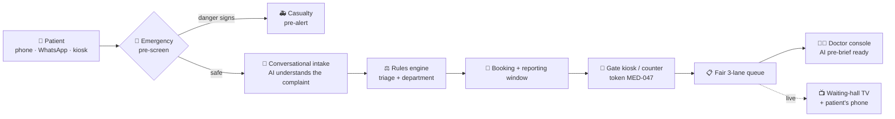
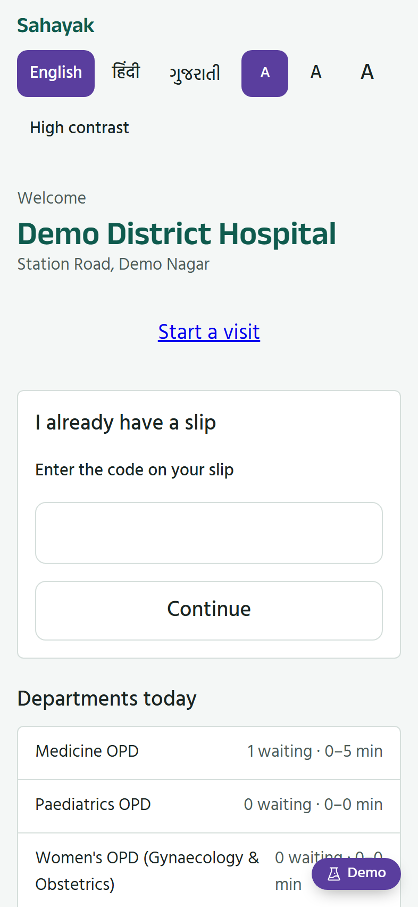
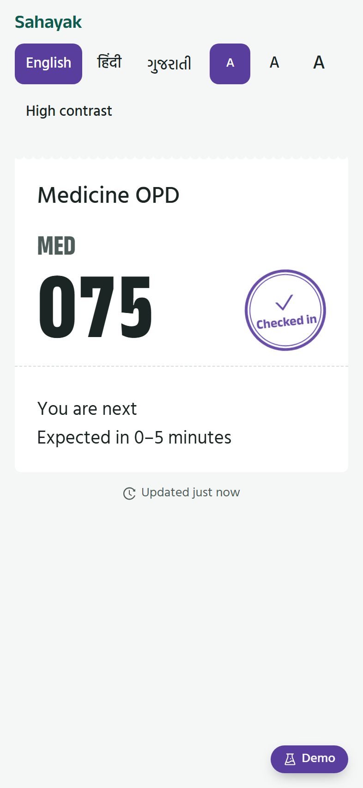
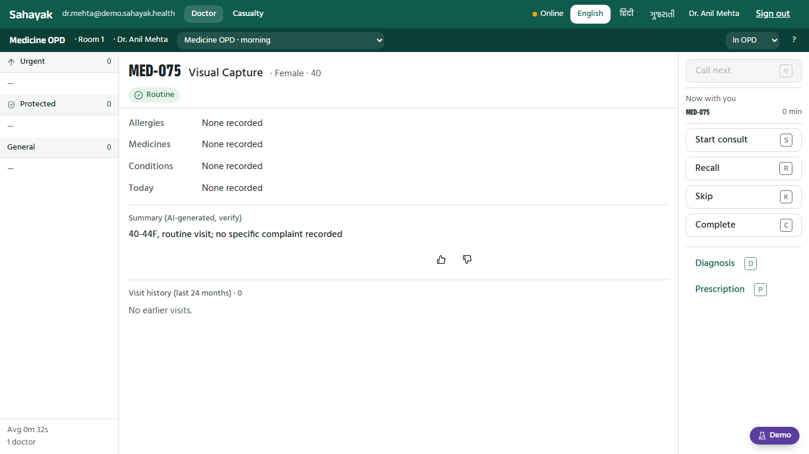
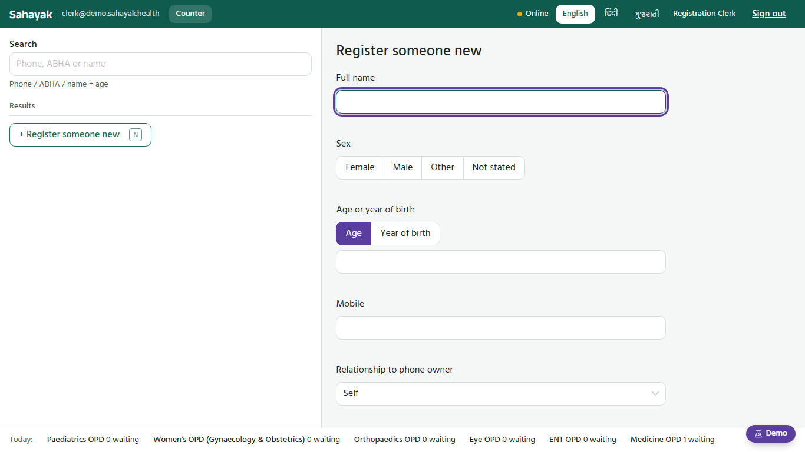
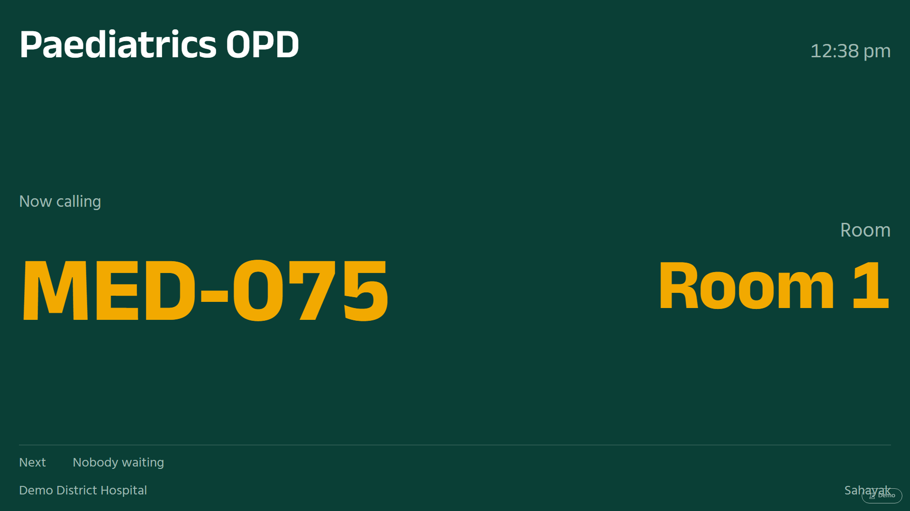
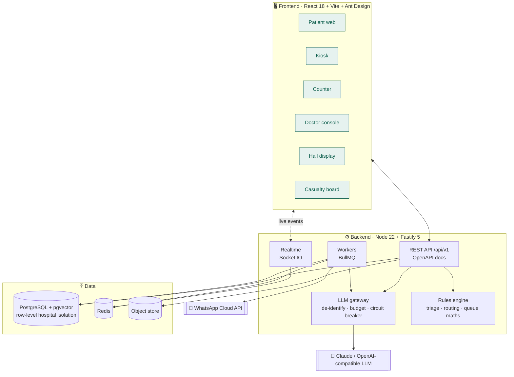

<div align="center">

# 🏥 Sahayak

### The AI-assisted front door for India's government hospital OPDs

**Intake → Triage → Fair queue → Doctor pre-brief**, in English, हिंदी and ગુજરાતી

<br/>


[The problem](#-the-problem) ·
[The solution](#-what-sahayak-does) ·
[How AI helps](#-how-ai-helps-and-where-it-is-not-allowed-to) ·
[Screenshots](#-screenshots) ·
[Architecture](#%EF%B8%8F-architecture) ·
[Run it](#-run-it-locally) ·
[Docs](#-documentation)

</div>

---

## 😷 The problem

Walk into the out-patient department (OPD) of a busy Indian district hospital at 8 a.m.:

| Pain point | What it looks like on the ground |
|---|---|
| ⏳ **Hours in line, no information** | Hundreds of patients queue for a paper slip, then queue again outside a room, with no idea how long it will take. |
| 🚨 **Emergencies stuck in the OPD line** | A person with chest pain or a pregnant woman with bleeding waits in the same line as someone with a cold. |
| 🔀 **Wrong department** | Patients don't know whether "burning in the stomach" means Medicine or another OPD, so they are sent back and queue again. |
| 🧑‍⚕️ **Doctors start every consult from zero** | Consultations are short, and much of that time goes on asking for history, allergies and medicines that are already on record somewhere. |
| 🤝 **Unfair queues** | Tokens get "managed", the elderly and disabled get pushed back, and nobody can explain why someone else went first. |
| 🗣️ **Language and literacy** | Forms are in English; many patients speak Hindi, Gujarati or Hinglish and may not read at all. |

## 💡 What Sahayak does

Sahayak (सहायक, "helper") digitises the whole OPD front door, **from the patient's phone to the doctor's desk**:



- **📱 Book before you arrive.** A chat-style intake in three languages, by text, buttons or voice. One phone can register the whole family, and ASHA workers can register villagers.
- **🚨 Emergencies never wait.** Danger phrases such as "chest pain", "can't breathe" or "saanp ne kata" end the intake on the spot and alert the Casualty team before any AI call is made.
- **🎯 Right department, first time.** Clinician-written rules plus an AI suggestion route each patient to the right OPD.
- **⚖️ A queue that can explain itself.** Three lanes (Urgent, Protected for elderly, pregnant and disabled, and General) with a 1 : 2 rotation and an aging guard, so nobody waits more than two hours unseen. The doctor presses **N** and the server picks the next patient; nobody can jump the line by hand.
- **📺 Live everywhere.** The waiting-hall TV, the patient's phone slip and the doctor's console all update within a second over WebSockets, with a chime when a token is called.
- **📋 The doctor walks in prepared.** A one-screen **pre-brief** with exact facts from the record and an AI-written summary, prepared in the background before the patient is called.
- **🛜 Keeps working offline.** Kiosks hold reserved token blocks, and if the AI is down the app falls back to menus and rules. The hospital keeps running.

## 🤖 How AI helps, and where it is *not* allowed to

> **Design principle:** AI does the language work. Clinician-written rules make the safety decisions. Switch the AI off and the whole flow still works.

AI helps in **four places**, all behind one gateway ([`backend/src/infra/llm/`](backend/src/infra/llm/)):

| # | 🤖 AI task | Example | If the AI is unavailable |
|:-:|---|---|---|
| 1 | **Understand free-text complaints** | `"pet mein jalan hai 3 din se"` → *epigastric burning, 3 days*, chosen only from a 159-symptom catalogue | Body-area menu → symptom list |
| 2 | **Suggest the department** and rank the next clarifying question | Used only if ≥ 60 % confident, after the hard rules (pregnant → Women's OPD, under 14 → Paediatrics…) | Rules → symptom's default specialty → Medicine OPD |
| 3 | **Write the doctor's pre-brief** | Headline, visit-history summary, key points, *possible conditions to consider* and *questions to ask*, labelled **"AI-generated, verify"** | "Summary unavailable. The facts above are complete." |
| 4 | **Answer hospital questions** (RAG over pgvector) | "What documents do I need for my Ayushman card?", answered **only** from the hospital's own documents, with citations | Curated FAQ → "Please ask the help desk" |

### 🛡️ Guardrails built into the code

| | Guardrail |
|:-:|---|
| 🚫 | **Never diagnoses or prescribes to a patient.** This follows India's Telemedicine Practice Guidelines: AI may only assist a registered doctor. |
| ⬆️ | **AI can only make urgency *higher*, never lower**, and the database enforces this. |
| 🕵️ | **De-identified before every call.** Names, phone numbers, ABHA ids and addresses are stripped, age becomes a 5-year band and dates become relative ([`deidentify.js`](backend/src/infra/llm/deidentify.js)). |
| 💊 | **No hallucinated medicines.** Any medicine or allergen the AI mentions must already be in the record, or that line is dropped. |
| ✅ | **Separate AI consent.** If a patient says no, they get a menu-only intake and no AI call is made. |
| 📊 | **Every call is logged** (prompt version, tokens), with a daily token budget per hospital and a circuit breaker. |
| 👍 | **Doctor feedback loop.** Helpful / Not helpful votes on each pre-brief go to clinical reviewers every week. |
| 🧪 | **Evals in the repo.** [`backend/evals/`](backend/evals/) scores intake extraction, routing, KB answers and pre-briefs; run them whenever you change a prompt or a model. |

**Pluggable provider.** Set `LLM_PROVIDER` to `anthropic` for **Claude**, or to `openai` for any OpenAI-compatible API (Groq, OpenAI, Gemini…). A **fast** model handles intake and routing; a **smart** model writes the pre-brief.

## 📸 Screenshots

<table>
  <tr>
    <td align="center" width="30%"><br/><b>📱 Patient: hospital page</b><br/><sub>Live department waits, 3 languages, large text, high contrast</sub></td>
    <td align="center" width="30%"><br/><b>🎫 Patient: live slip</b><br/><sub>Position, room and expected wait, updated in real time</sub></td>
    <td align="center" width="40%"><br/><b>👩‍⚕️ Doctor console</b><br/><sub>3-lane queue, record facts, AI pre-brief, keyboard shortcuts</sub>
    <br/><br/><br/><b>🧾 Registration counter</b><br/><sub>Keyboard-first walk-in registration and check-in</sub></td>
  </tr>
  <tr>
    <td colspan="3" align="center"><br/><b>📺 Waiting-hall TV</b><br/><sub>Token codes only, never names · rotates English → हिंदी → ગુજરાતી · chime on every call</sub></td>
  </tr>
</table>

## 🏗️ Architecture



<details>
<summary><b>🔐 Security and privacy highlights</b></summary>
<br/>

- **Two-factor sign-in (TOTP)** for doctors, admins, clinical reviewers and the data protection officer
- **Every view of a record is audited**, and the log is written *before* the data is shown. Patients can ask who accessed their record.
- **Role-scoped data:** clerks see demographics only; doctors see clinical data only for patients in their care, with reviewed "break-glass" access
- **Hospital isolation in the database itself** through row-level security: a request without a hospital context returns nothing
- **Four-eyes rule publishing:** a triage rule set must pass its own test cases and be approved by a second clinician before it goes live, and every decision can be replayed
- **No Aadhaar.** ABHA is the only health id, and it is optional. Consent is versioned and recorded per language and channel.
- **Optimistic concurrency** (`If-Match`) and **idempotency keys**, so a kiosk retry never creates a second token
- **Custom ESLint safety rules**: patient-data tables may only be queried inside repository files, and string-built SQL is forbidden

</details>

<details>
<summary><b>📁 Repository layout</b></summary>
<br/>

```
hospital_project/
├── frontend/        React 18 + Vite (JSX), React Router, Context, Axios, Socket.IO client, Ant Design
├── backend/
│   ├── src/apps/    api · realtime · worker · scheduler · outbox · webhook entry points
│   ├── src/modules/ intake · triage · queue · prebrief · kb · patients · auth · audit · whatsapp · …
│   ├── src/infra/   llm gateway, db, redis, crypto, storage, embeddings, asr, sms
│   ├── db/          11 SQL migrations + demo seed
│   └── evals/       LLM evaluation sets
├── e2e/             Playwright browser tests (+ axe accessibility checks)
├── scripts/         TOTP helper, narrated overview-video recorder
└── docs/            how it works, demo guide, developer guide, screenshots
```

</details>

## 🚀 Run it locally

**Needs:** Node 22+, npm and Docker Desktop.

```bash
npm run install:all      # root, frontend and backend dependencies
cp backend/.env.example backend/.env && cp frontend/.env.example frontend/.env
npm --prefix backend run keys:gen   # generate fresh development keys
npm run backend:infra    # Postgres, PgBouncer, Redis, object store (Docker)
npm run backend:migrate  # 11 SQL migrations
npm run backend:seed     # demo hospital, departments, staff, devices, symptoms, rules
npm run dev              # backend (:3000 api, :3001 realtime, :8000 gateway) + frontend (:5173)
```

Then open **http://localhost:5173/demo** for the **15-minute guided tour**. Its buttons open every screen already signed in.

> 💡 **No AI key? It still works.** Without an LLM key the app runs on its deterministic fallback path. To turn the AI on, set `LLM_PROVIDER` and `ANTHROPIC_API_KEY` (or `OPENAI_BASE_URL` + `OPENAI_API_KEY`) in `backend/.env`.

| Command | What it does |
|---|---|
| `npm test` | Frontend and backend unit tests (rules engine, clinical safety, queue maths, de-identification) |
| `npm run e2e` | Playwright end-to-end tests against the running stack |
| `npm run backend:smoke` | Full backend story: login → registration → token → call-next → intake → knowledge base → audit |
| `npm --prefix backend run eval -- department_route` | Score the LLM on a labelled eval set |

## 📚 Documentation

| Doc | For |
|---|---|
| 📖 [**How it works**](docs/HOW_IT_WORKS.md) | Everyone: every screen, the patient journey, the queue rules, what the AI does and doesn't do, FAQ |
| 🎬 [**Demo guide**](docs/DEMO_GUIDE.md) | Presenting it: a role-play script across patient, kiosk, counter, doctor and TV |
| 🛠️ [**Developer guide**](docs/DEVELOPER_GUIDE.md) | Environment files, every screen URL and login, API conventions, commands |
| 🏛️ [**Backend design**](backend/BACKEND_DESIGN.md) | The full backend architecture and decisions |

## 🗺️ Roadmap

- [x] Multilingual conversational intake with emergency pre-screen
- [x] Rules-engine triage, department routing and a fair 3-lane queue
- [x] Kiosk, counter, doctor console, hall display and casualty board
- [x] AI doctor pre-brief and hospital knowledge bot with citations
- [x] WhatsApp channel in the backend
- [ ] Admin web screens (staff, devices, schedules, rule approval, analytics); available through the API today
- [ ] Larger clinician-labelled eval sets before go-live

---

<div align="center">

**Built to make the first hour of a hospital visit shorter, fairer and safer.**

⭐ Star the repo if you find it useful.

</div>
